<p align="center">
  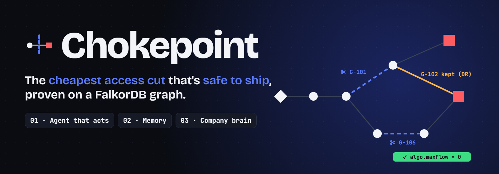
</p>

<p align="center">
  
  
  
  
  
  
</p>

<h3 align="center">A CI token leaks. Your SIEM gives you 40 alerts.<br>Chokepoint gives you a fix your company can actually ship, and a proof.</h3>

<p align="center">
  <a href="#demo">Demo</a> ·
  <a href="#what-you-see">Tour</a> ·
  <a href="#how-it-works">How it works</a> ·
  <a href="#run-it">Run it</a> ·
  <a href="#graph-data-model">Data model</a> ·
  <a href="#queries-and-algorithms-the-product-depends-on">Queries</a>
</p>

---

Chokepoint is an identity attack-path triage agent built on [FalkorDB](https://falkordb.com). It runs on one graph of a company's people, roles, grants, systems, tickets, chat and runbooks:

1. 🔎 **Find:** every route from a security finding to the crown-jewel systems (`algo.bfs`).
2. ✂️ **Cut:** the **cheapest set of grants to revoke** with `algo.maxFlow` (a min-cost cut).
3. 📚 **Check:** a Gemini agent **reads the company's own records** to make sure the fix won't break something. The demo case: a "dormant" grant that disaster-recovery failover actually needs.
4. ✅ **Prove:** every route is cut (`algo.maxFlow = 0`). It names the owners and drafts the tickets.
5. 🧠 **Remember:** accepted risks become **memory in the graph**. They change the next answer and re-check themselves when the graph or the calendar moves.

Built for **Graph Hacks: Context for AI Agents** (WeMakeDevs × FalkorDB).

| 128 | 11 | 888 · 958 | 6 / 6 | 0 |
|:---:|:---:|:---:|:---:|:---:|
| tests on a real FalkorDB, no mocks | graph tools, also served over MCP | nodes · attack edges in the demo graph | live Gemini runs that kept DR safe¹ | decisions saved without a human |

<sub>¹ 2 Oct 2026, finding F-1, `gemini-2.5-flash` + `gemini-3.5-flash`. Runs stopped by the free-tier quota fell back to the graph's plan and are not counted.</sub>

## Demo

<a href="docs/media/chokepoint-demo.mp4">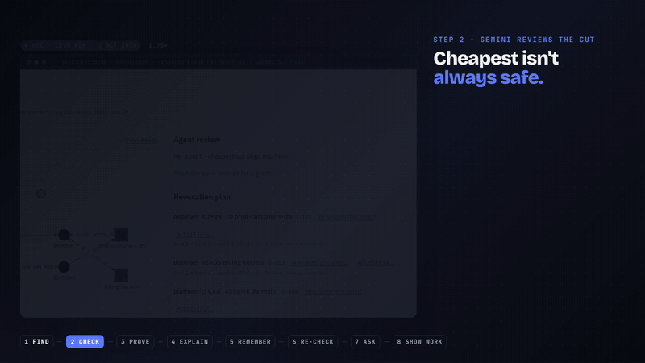</a>

<p align="center">
  <a href="docs/media/chokepoint-demo.mp4"><b>▶ Watch the full demo (1:57, with voice-over)</b></a><br>
  <sub>Every screen is a real live run (Gemini + FalkorDB Cloud, 2 Oct 2026), only sped up. How it was made: <a href="video/README.md">video/README.md</a></sub>
</p>

## Three tracks, one graph

| | Track | What Chokepoint does |
|:---:|---|---|
| 🤖 | **01 · Agents that act on connected data** | <ul><li>Multi-hop attack paths (`algo.bfs`), the min-cost cut (`algo.maxFlow`), counterfactual `what_if` cuts and the shortest route (`algo.SPpaths`), all as tools, also over MCP.</li><li>The agent picks the plan; the graph proves it.</li></ul> |
| 🧠 | **02 · Agent memory & coordination** | <ul><li>Decisions are graph nodes that set grant capacities, so memory changes the next computation.</li><li>Every decision has a `review_by` date and cited sources, and is re-validated as HOLDS / NEEDS REVIEW / STALE / SUPERSEDED.</li><li>Each visitor gets an isolated graph (`GRAPH.COPY`).</li></ul> |
| 🏢 | **03 · Company brain** | <ul><li>Tickets, chat and policy docs live in the same graph as the access.</li><li>"Why does this grant exist?" follows ticket → requester → approver → chat → policy.</li><li>Answers who-knows, flags policy drift, and cites a source for every claim.</li></ul> |

The tracks feed each other. The company brain is the evidence the agent reads. The agent's plan becomes a decision in memory. That memory changes the next cut.

## What you see

All screenshots are real frames from the live run.

<table>
  <tr>
    <td colspan="2">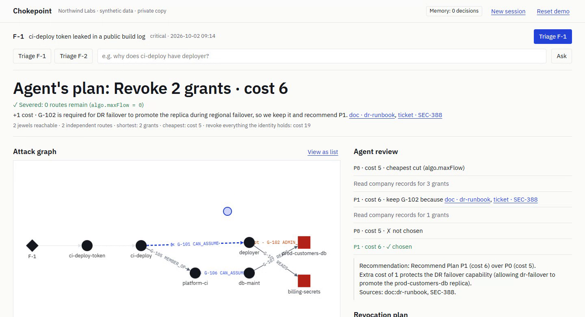</td>
  </tr>
  <tr>
    <td colspan="2"><b>1 · The agent's plan.</b> The graph's cheapest cut costs 5, but it would revoke G-102, which DR failover needs. Gemini asks the graph for the cheapest plan that keeps it: <b>cost 6</b>. The server proves <code>algo.maxFlow = 0</code>.</td>
  </tr>
  <tr>
    <td width="60%">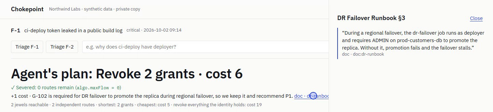<br><b>2 · Every claim has a source.</b> Click a citation and you read the runbook itself. A citation only counts if the agent was shown that source in this run.</td>
    <td width="40%" rowspan="2">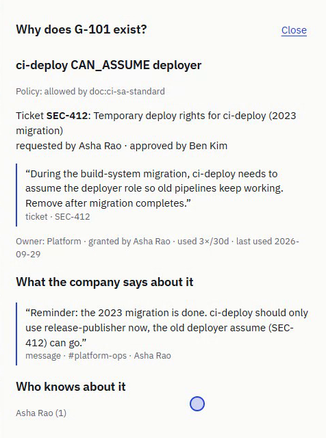<br><b>3 · Company brain.</b> "Why does this exist?" returns the ticket, who asked, who approved, the chat that says it can go, and who to ask.</td>
  </tr>
  <tr>
    <td>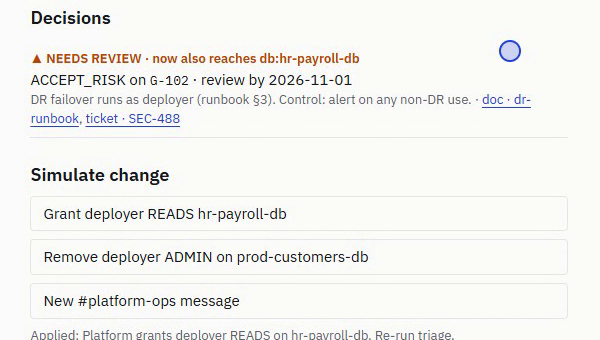<br><b>4 · Memory that re-checks itself.</b> Platform grants deployer READS hr-payroll-db, and the accepted risk flips to <b>NEEDS REVIEW · now also reaches hr-payroll-db</b>.</td>
  </tr>
  <tr>
    <td colspan="2">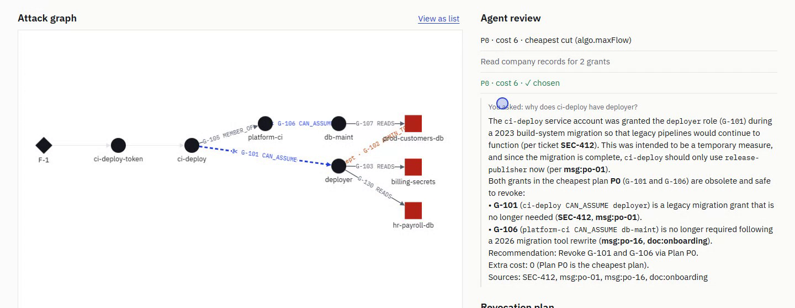<br><b>5 · Ask anything.</b> The remembered decision already shapes the new plan (cost 6, +0). The answer cites SEC-412 and the #platform-ops thread.</td>
  </tr>
  <tr>
    <td colspan="2">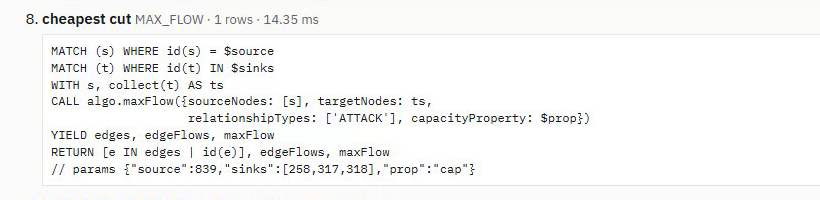<br><b>6 · No black box.</b> Every Cypher query and <code>algo.*</code> call of the run is listed with its params, row count and time.</td>
  </tr>
</table>

## How it works

<p align="center">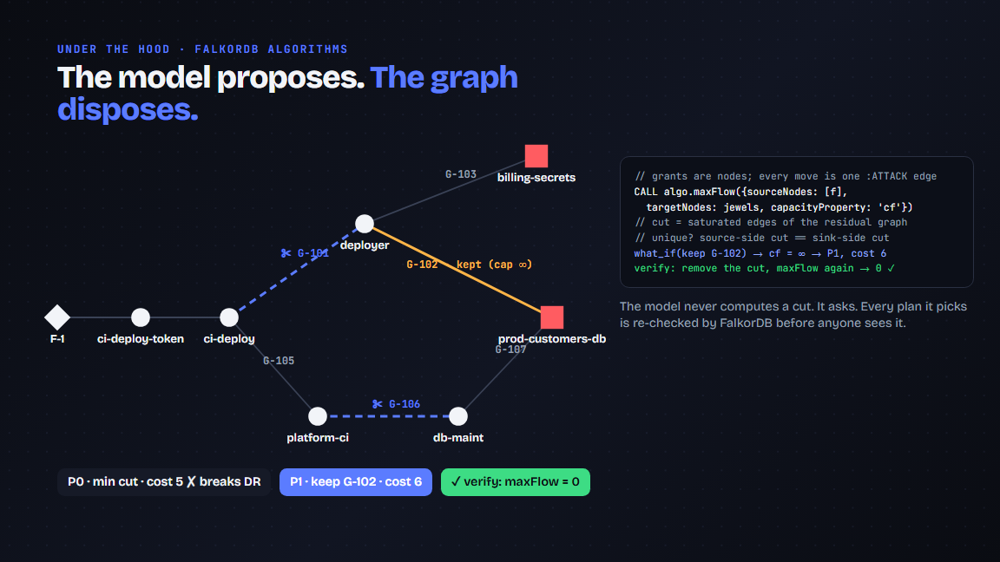</p>

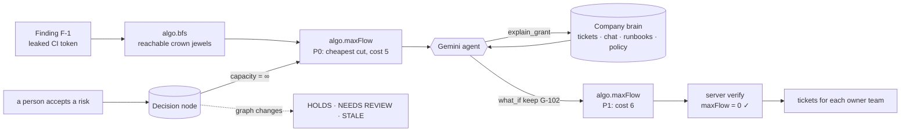

**The LLM proposes, the graph disposes.**
- The model never computes a cut. It reads evidence and proposes constraints that must cite a doc, ticket or message it was shown in this run.
- FalkorDB recomputes and proves every proposal.
- Without an API key (or if the model fails), the app still shows the cheapest plan, verified, labelled "Not reviewed by agent".

<details>
<summary><b>The same story in plain text</b></summary>

```
F-1 ─▶ ci-deploy-token ─▶ ci-deploy ─G-101─▶ deployer ─G-102 (DR grant, unused 70d)─▶ ★ prod-customers-db
                              │                  └─G-103 (unused)──────────────────▶ ★ billing-secrets
                              └─G-105─▶ platform-ci ─G-106─▶ db-maint ─G-107───────▶ ★ prod-customers-db

cheapest cut (algo.maxFlow)  P0 = {G-102, G-103, G-106}  cost 5
agent reads company records  "DR Failover Runbook §3: the dr-failover job runs as deployer and
                              requires ADMIN on prod-customers-db". The dependency register says
                              nothing; usage says dormant.
what_if(keep G-102)          P1 = {G-101, G-106}  cost 6   ✓ Severed: algo.maxFlow = 0
keyword matcher (strawman)   keeps G-102, G-103 and G-106 → {G-101, G-107}  cost 8  (wrong; CI proves it)
```

</details>

**Stack:** FalkorDB (Cloud or Docker) · Python 3.12 · FastAPI + SSE · Cytoscape.js · Google Gemini (`google-genai`, function calling) · MCP server (`mcp`) · pytest against a real FalkorDB, with networkx as the test oracle.

## Run it

```bash
docker compose up --build          # FalkorDB + app on http://localhost:8000 (FalkorDB Browser on :3000)
```

Or run it locally:

```bash
docker run -d -p 6379:6379 falkordb/falkordb:latest
python -m venv .venv && . .venv/bin/activate          # Windows: .venv\Scripts\activate
pip install -r requirements-dev.txt
cp .env.example .env                                  # add GEMINI_API_KEY (see docs/ENV_SETUP.md)
python -m chokepoint.cli seed                         # builds + verifies the Northwind graph
uvicorn chokepoint.web:app --port 8000
```

No Gemini key? Everything except the agent's review still works. Every value in `.env`, and where to get it: [docs/ENV_SETUP.md](docs/ENV_SETUP.md).

Other commands:

```bash
python -m chokepoint.cli ask F-1 --no-llm   # triage in the terminal (deterministic path)
python -m chokepoint.cli ask F-1            # with the agent (needs GEMINI_API_KEY)
python -m chokepoint.cli eval -n 3          # real-model gate: must keep only G-102 and cite the runbook
python -m chokepoint.cli mcp                # MCP server (stdio) for any MCP client (Gemini CLI, Claude, Cursor)
pytest -q                                   # 128 tests against a real FalkorDB, stub LLM
```

**Demo script:**
1. Triage F-1. The agent keeps the DR grant and you get P1, severed.
2. Open "Why does this exist?" on G-101 or G-102 to see the provenance chain (and, on G-102, the **policy violation**).
3. Accept risk on the kept G-102, citing `doc:dr-runbook`, and re-triage. The plan routes around it.
4. Simulate "Grant deployer READS hr-payroll-db". The decision flips to NEEDS REVIEW.
5. Triage F-2: memory HOLDS, and you see the tie line.

## Graph data model

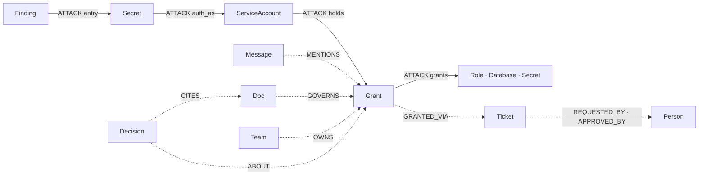

Solid edges are `:ATTACK` (the only edges the algorithms traverse); dotted edges are context.

Grants are **nodes**, so decisions, tickets, owners and chat can point at them. Only `:ATTACK` edges are traversed by the algorithms. Knowledge edges are context.

```
Movement (algo.bfs / algo.maxFlow / algo.SPpaths traverse ONLY these)
  (holder)-[:ATTACK {kind:'holds', cap, unit:1, w:1}]->(:Grant)-[:ATTACK {kind:'grants', cap:BIG}]->(target)
  (:Secret)-[:ATTACK {kind:'auth_as'}]->(:ServiceAccount)    (:Host)-[:ATTACK {kind:'session'}]->(:Person)
  (:Finding)-[:ATTACK {kind:'entry'}]->(entry point)

Nodes
  :Person :Team :Group :Role :ServiceAccount :Host :Database :Bucket :Secret {crown_jewel}
  :Grant {id, kind, cost, uses_30d, last_used, revocable, holder_id, target_id}
  :Service {criticality}  :Finding  :Ticket {title, body}  :Thread  :Message {text}  :Doc {title, section, text}
  :Decision {disposition, status, rationale, review_by, cited_ids, baseline_jewels}

Context (never traversed by the cut)
  (:Team)-[:OWNS]->(x)   (:Person)-[:MEMBER_OF_TEAM]->(:Team)   (:Grant)-[:GRANTED_BY]->(:Person)
  (:Grant)-[:GRANTED_VIA]->(:Ticket)-[:REQUESTED_BY|APPROVED_BY]->(:Person)
  (:Person)-[:WROTE]->(:Message)<-[:HAS]-(:Thread)
  (:Message|:Ticket|:Doc)-[:MENTIONS {span}]->(…)      (:Doc)-[:GOVERNS {allows}]->(…)
  (:Service)-[:DEPENDS_ON_GRANT]->(:Grant)
  (:Decision)-[:ABOUT]->(:Grant)  (:Decision)-[:CITES]->(…)  (:Decision)-[:SUPERSEDES]->(:Decision)
```

**Grant cost** is the business friction of revoking it, derived from usage: `cost = 1 + ceil(log2(1 + uses_30d))`.
- Known breakage (`DEPENDS_ON_GRANT`) is reported separately as `services_broken`.
- An ACTIVE `ACCEPT_RISK` decision sets the grant's capacity to `BIG`, so the cut has to route around it.

## Why FalkorDB (honest version)

- **The algorithms run in the database, on the system of record.**
  - Every tool the agent calls is a FalkorDB query or `algo.*` procedure, run against the live graph where decisions and knowledge are written.
  - There is no export or ETL step, so a recorded decision changes the very next cut.
  - At hackathon scale, networkx in-process would be just as fast. The point is one store for every tool, tenant and session.
- **Multigraph tenancy:** every visitor works on an isolated `GRAPH.COPY` of Northwind in one instance. Counterfactual capacities and decisions never cross tenants.
- **One graph for attacks, memory and company knowledge.** The provenance the agent cites lives in exactly the graph that gets cut.
- **Rule-3 audit:** remove FalkorDB and nothing renders. Paths, cuts, counterfactuals, proof, memory, provenance, who-knows, policy drift and tenancy are all graph calls.

## Correctness

- **Cut:** FalkorDB returns flows, not the cut. The cut is read from the residual graph (source side and sink side) and asserted: `cut capacity == maxFlow`.
  - The min cut is unique iff both sides agree. Ties are shown and broken by fewest known services broken, then earliest in the kill chain.
- **Routes:** one unit-capacity `algo.maxFlow` into FalkorDB's built-in virtual super-sink. Tested equal to networkx; Menger guarantees `routes ≤ |cut|` (strictly less in the demo).
- **Counterfactuals:** a temporary `cf` property is written on **every** `:ATTACK` edge (FalkorDB rejects a missing capacity), under a per-graph lock. It is overwritten before read and cleared in `finally`.
- **Seeding** verifies `expected.yaml` through the real queries before the template goes live.
- **Probe results** for FalkorDB behaviour (directed BFS, tree-only BFS edges, multi-sink maxFlow, `GRAPH.COPY`, `RO_QUERY`): `notes/falkordb-probes.md`.

## Queries and algorithms the product depends on

Generated from `chokepoint/queries.py`. CI fails if this section drifts.

<!-- queries:start -->
### `BFS_NODES`

```cypher
MATCH (f:Finding {id: $finding})
CALL algo.bfs(f, 64, 'ATTACK') YIELD nodes
RETURN id(f), [n IN nodes | id(n)]
```

### `INDUCED_EDGES`

```cypher
MATCH (a)-[r:ATTACK]->(b) WHERE id(a) IN $ids
RETURN id(a), id(b), id(r), r.kind, r.cap, r.unit
```

### `NODE_INFO`

```cypher
MATCH (n) WHERE id(n) IN $ids
RETURN id(n), n.label, n.id, n.name, coalesce(n.crown_jewel, false),
       n.kind, n.cost, n.uses_30d, n.revocable, n.holder_id, n.target_id, n.owner
```

### `MAX_FLOW`

```cypher
MATCH (s) WHERE id(s) = $source
MATCH (t) WHERE id(t) IN $sinks
WITH s, collect(t) AS ts
CALL algo.maxFlow({sourceNodes: [s], targetNodes: ts,
                   relationshipTypes: ['ATTACK'], capacityProperty: $prop})
YIELD edges, edgeFlows, maxFlow
RETURN [e IN edges | id(e)], edgeFlows, maxFlow
```

### `CLEAR_CF`

```cypher
MATCH ()-[r:ATTACK]->() WHERE r.cf IS NOT NULL REMOVE r.cf
```

### `WRITE_CF`

```cypher
MATCH ()-[r:ATTACK]->()
SET r.cf = CASE
  WHEN id(r) IN $zero THEN 0
  WHEN id(r) IN $big THEN $BIG
  WHEN $base = 'unit' THEN r.unit
  WHEN $base = 'big' THEN $BIG
  ELSE r.cap END
```

### `COUNT_CF`

```cypher
MATCH ()-[r:ATTACK]->() WHERE r.cf IS NOT NULL RETURN count(r)
```

### `SHORTEST_PATH`

```cypher
MATCH (f:Finding {id: $finding}), (t) WHERE id(t) = $target
CALL algo.SPpaths({sourceNode: f, targetNode: t, relTypes: ['ATTACK'],
                   weightProp: 'w', pathCount: 1})
YIELD path, pathWeight
RETURN [n IN nodes(path) | n.id], [n IN nodes(path) | n.label], pathWeight
```

### `SERVICES_BROKEN`

```cypher
MATCH (s:Service)-[:DEPENDS_ON_GRANT]->(g:Grant) WHERE g.id IN $grants
RETURN g.id, collect(s.name)
```

### `GRANT_CONTEXT`

```cypher
MATCH (g:Grant) WHERE g.id IN $grants
OPTIONAL MATCH (g)-[:GRANTED_VIA]->(t:Ticket)
OPTIONAL MATCH (t)-[:REQUESTED_BY]->(req:Person)
OPTIONAL MATCH (t)-[:APPROVED_BY]->(apr:Person)
OPTIONAL MATCH (g)-[:GRANTED_BY]->(gb:Person)
OPTIONAL MATCH (team:Team)-[:OWNS]->(g)
RETURN g.id, g.kind, g.holder_id, g.holder_name, g.target_id, g.target_name, g.cost,
       g.uses_30d, g.last_used, g.revocable,
       t.id, t.title, t.body, req.name, apr.name, gb.name, team.name
```

### `GRANT_MENTIONS`

```cypher
MATCH (src)-[m:MENTIONS]->(g:Grant {id: $grant})
WHERE src:Message OR src:Ticket OR src:Doc
OPTIONAL MATCH (author:Person)-[:WROTE]->(src)
OPTIONAL MATCH (th:Thread)-[:HAS]->(src)
RETURN src.id, src.label, coalesce(src.text, src.body), m.span,
       coalesce(src.title, th.channel), src.section, author.name
```

### `GOVERNING_DOCS`

```cypher
MATCH (g:Grant {id: $grant})
MATCH (d:Doc)-[gv:GOVERNS]->(h:E) WHERE h.id = g.holder_id
RETURN d.id, d.title, d.section, d.text, gv.allows
```

### `GRANT_DECISIONS`

```cypher
MATCH (d:Decision {grant_id: $grant})
RETURN d.id, d.disposition, d.status, d.rationale, d.review_by, d.by, d.at, d.cited_ids
ORDER BY d.at DESC
```

### `WHO_KNOWS`

```cypher
MATCH (n:E {id: $node})
OPTIONAL MATCH (g:Grant) WHERE g.holder_id = $node OR g.target_id = $node OR g.id = $node
WITH n, collect(g) + [n] AS subjects
UNWIND subjects AS s
MATCH (src)-[:MENTIONS]->(s)
OPTIONAL MATCH (p1:Person)-[:WROTE]->(src)
OPTIONAL MATCH (src)-[:REQUESTED_BY|APPROVED_BY]->(p2:Person)
WITH [x IN [p1, p2] WHERE x IS NOT NULL] AS ps, src
UNWIND ps AS p
RETURN p.id, p.name, count(DISTINCT src) AS score
ORDER BY score DESC, p.name ASC
LIMIT 3
```

### `WHO_OWNS`

```cypher
MATCH (n:E) WHERE n.id IN $ids
OPTIONAL MATCH (t:Team)-[:OWNS]->(n)
OPTIONAL MATCH (p:Person)-[:MEMBER_OF_TEAM]->(t)
RETURN n.id, coalesce(n.name, n.id), t.name, collect(p.name)
```

### `HOLDER_REACH`

```cypher
MATCH (g:Grant {id: $grant})
MATCH (h:E) WHERE h.id = g.holder_id
CALL algo.bfs(h, 64, 'ATTACK') YIELD nodes
RETURN [n IN nodes WHERE n.crown_jewel = true | n.id]
```

### `RECORD_DECISION`

```cypher
MATCH (g:Grant {id: $grant})
OPTIONAL MATCH (old:Decision {status: 'ACTIVE'})-[:ABOUT]->(g)
WITH g, collect(old) AS olds
FOREACH (o IN olds | SET o.status = 'SUPERSEDED')
CREATE (d:Decision {id: $did, grant_id: $grant, disposition: $disp, rationale: $rationale,
                    review_by: $review_by, by: $by, at: $at, status: 'ACTIVE',
                    cited_ids: $cites, baseline_jewels: $baseline})
CREATE (d)-[:ABOUT]->(g)
FOREACH (o IN olds | CREATE (d)-[:SUPERSEDES]->(o))
WITH d, g
MATCH ()-[r:ATTACK {kind: 'holds'}]->(g)
SET r.cap = CASE WHEN $disp = 'ACCEPT_RISK' OR g.revocable = false THEN $BIG ELSE g.cost END
RETURN d.id
```

### `LINK_CITES`

```cypher
MATCH (d:Decision {id: $did})
UNWIND $cites AS cid
MATCH (c:E) WHERE c.id = cid AND (c:Ticket OR c:Message OR c:Doc)
CREATE (d)-[:CITES]->(c)
```

### `WITHDRAW_DECISION`

```cypher
MATCH (d:Decision {id: $did, status: 'ACTIVE'})-[:ABOUT]->(g:Grant)
SET d.status = 'WITHDRAWN'
WITH g
MATCH ()-[r:ATTACK {kind: 'holds'}]->(g)
SET r.cap = CASE WHEN g.revocable = false THEN $BIG ELSE g.cost END
```

### `ALL_DECISIONS`

```cypher
MATCH (d:Decision)
OPTIONAL MATCH (d)-[:ABOUT]->(g:Grant)
RETURN d.id, d.grant_id, d.disposition, d.status, d.rationale, d.review_by, d.by, d.at,
       d.cited_ids, d.baseline_jewels, g IS NOT NULL
ORDER BY d.at DESC
```

### `GRANT_EXISTS`

```cypher
MATCH (g:Grant {id: $grant}) RETURN g.id
```

### `EXISTING_IDS`

```cypher
UNWIND $ids AS i MATCH (n:E {id: i}) RETURN n.id
```

### `VERIFY_CAPS`

```cypher
MATCH (h)-[r:ATTACK {kind: 'holds'}]->(g:Grant)
OPTIONAL MATCH (d:Decision {status: 'ACTIVE', disposition: 'ACCEPT_RISK'})-[:ABOUT]->(g)
WITH g, r, count(d) AS acc
WITH g, r, CASE WHEN acc > 0 OR g.revocable = false THEN $BIG ELSE g.cost END AS want
WHERE r.cap <> want
RETURN g.id, r.cap, want
```
<!-- queries:end -->

## Data

All data is **synthetic** (rule 6): the fictional company Northwind Labs.
- `chokepoint/scenario/northwind.yaml`: the hand-designed scenario.
- `knowledge.yaml`: tickets, chat and docs as plain text, including 3 decoy docs that mention `deployer` without blocking the fix.
- `generate.py`: seeded noise, about 900 nodes.
- `expected.yaml`: hand-derived answers, test-only.

Knowledge edges come from `cli ingest` (LLM extraction, validated and committed) or from the hand-written `knowledge_fallback.jsonl`.

## AI disclosure

This project was planned and built with Claude Code (Anthropic) as a coding assistant. The author reviewed the design, the graph model, the queries and the tests, and can explain them. The runtime agent uses **Google Gemini** through the `google-genai` SDK (`GEMINI_MODEL`, default `gemini-3.5-flash`). Anthropic Claude is supported as an alternative with `LLM_PROVIDER=anthropic`. CI never calls a model.

**Demo video and README visuals:**
- The screen footage was recorded by a Playwright script driving the real app.
- The motion graphics, banner and thumbnail are built with Remotion.
- The voice-over is AI-generated (Gemini TTS); the music is synthesized with ffmpeg.

Details: [video/README.md](video/README.md).
